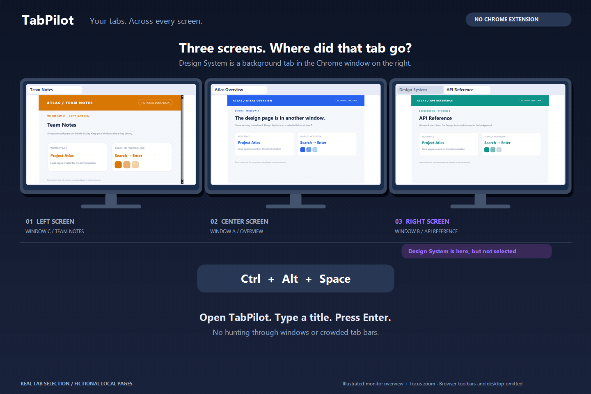
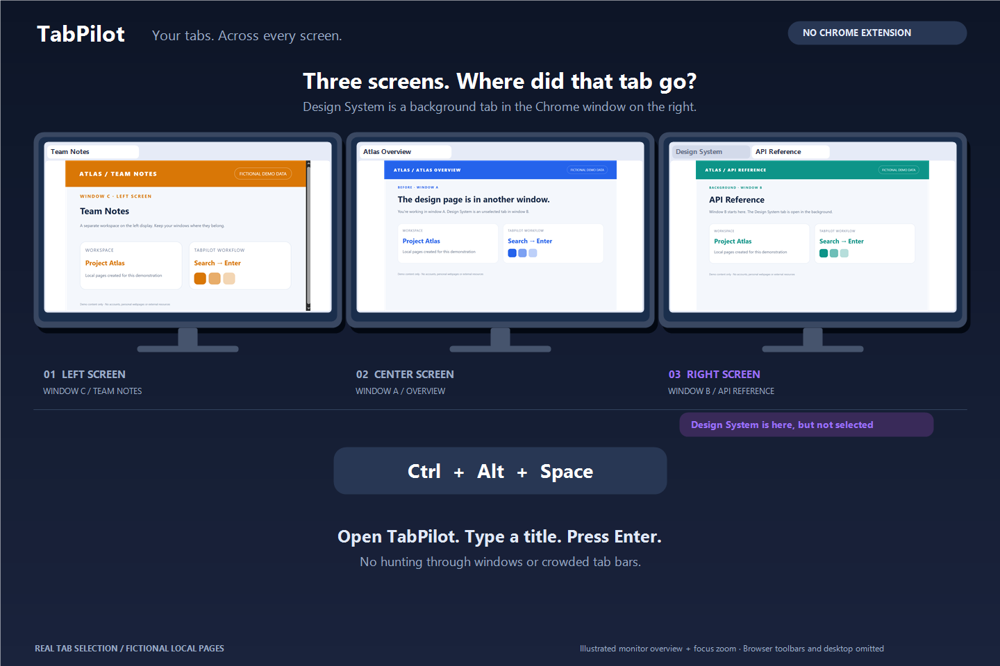
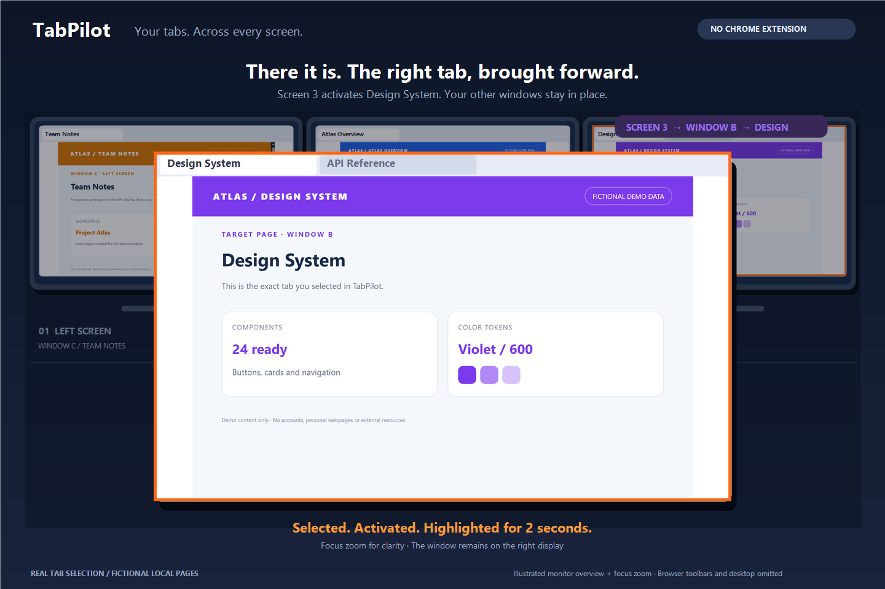

<div align="center">


### タブを見つけて、作業に集中。

[简体中文](README.md) · [English](README.en.md) · [日本語](README.ja.md) · [Español](README.es.md)

**[↓ Windows 版をダウンロード](https://github.com/aqvello/TabPilot/releases/tag/v0.2.1)** · [ソースからビルド](#build) · [互換性と制限](#limits)

Windows x64 · .NET Framework 4.8 · UI: 简体中文 / English · v0.2.1 Preview

</div>

複数のウィンドウとモニターに散らばった Chrome タブを探せる **Windows ネイティブのタブ切り替えツール**。ショートカットで開き、タイトルを検索して目的のタブへ。Chrome 拡張機能は不要です。

| | |
| :--- | :--- |
| **⌨ ショートカットで検索** | タイトル検索、↑↓ で選択、Enter で切り替え。 |
| **▦ 複数モニター** | モニター別表示、異なる DPI、位置の保存に対応。 |
| **◉ ネイティブ・ローカル** | UI Automation / Win32 を使用。Chrome の再起動や設定変更は不要。 |

## 操作の流れ



ウィンドウを一つずつ開いて探す必要はありません。ショートカットで TabPilot を開き、Design System を検索して Enter を押すと、右の画面にあるタブへ切り替わります。切り替え先のウィンドウはオレンジ色の枠でわかります。

デモにはサンプルページを使用しています。拡大は結果を見やすくするための演出です。[デモについて](docs/assets/README.md)

| 切り替え前：3 画面、対象タブは右画面のバックグラウンド | 切り替え後：右画面の対象を前面にして拡大表示 |
| :---: | :---: |
|  |  |

## 中国語・英語の画面

| 簡体字中国語 | English |
| :---: | :---: |
|  |  |

<details>
<summary>追加画像：検索とモニター別表示</summary>

| タイトル検索 | モニター別表示 |
| :---: | :---: |
|  |  |

</details>

## 使い始める

1. プレビュー版 Release から `TabPilot-Windows-x64.zip` をダウンロードして展開します。
2. 同じフォルダーに `.config` ファイルを残し、`TabPilot.exe` を実行します。
3. 登録されたショートカットで開きます。既定は **Ctrl + Alt + Space**。使用中の場合は別の組み合わせを試し、実際のキーを画面に表示します。
4. タイトルを検索し、結果をクリックするか ↑↓ と Enter で選びます。対象ウィンドウを前面にして約 2 秒強調表示します。Esc または画面外のクリックでトレイに隠れます。

Windows 10 1703+ x64 と .NET Framework 4.8 が必要です。**v0.2.1 はプレビュー版**です。Windows 10 / Chrome 156 でローカル検証していますが、すべての環境での動作を保証しません。

## 表示言語

アプリの表示言語は **簡体字中国語と英語**です。画面右上の **中文 / EN**、またはトレイの **Language / 语言** で切り替えられ、再起動後も保存されます。ページタイトルや OS・Chrome の診断情報は原文を維持します。日本語・スペイン語は README の翻訳であり、アプリ UI の対応言語ではありません。

## 主な操作

| 操作 | キー・入口 |
| :--- | :--- |
| 表示・非表示 | 登録済みのグローバルショートカット |
| 選択・切り替え | ↑↓ / Enter |
| 隠す・終了 | Esc / Ctrl + Q |
| 更新 | F5 / Ctrl + R |
| すべて・モニター別・最近 | Ctrl + 1 / 2 / 3 |
| 位置の保存 | 上部のタイトルをドラッグ |

<a id="limits"></a>

## 互換性と制限

- **読み取れた一覧が全タブとは限りません。** 折りたたまれたグループ、権限、Provider の動作により欠落する場合があります。完全性は未確認として表示します。
- **前面への移動は Windows の制御を受けます。** ダイアログ、権限差、フォーカスの競合により失敗することがあり、結果を検証して報告します。
- 複雑な折りたたみグループ、管理者権限の Chrome、仮想デスクトップなどは十分に検証していません。
- バックグラウンドタブの URL は確実に取得できません。ウィンドウ情報を表示し、Recent は TabPilot 経由の成功した切り替えだけを記録します。

## データとプライバシー

TabPilot 自体はタブ情報をアップロードせず、Chrome のプロファイル、履歴、セッションファイルも読みません。独自の設定と診断は書き込み可能な `data`、または `%LOCALAPPDATA%\TabPilot` に保存します。設定には原子的置換、バックアップ、再試行があります。診断にはタイトルが含まれるため、共有前に確認してください。画像の作成方法は [素材の説明](docs/assets/README.md) を参照してください。

<a id="build"></a>

## ソースからビルド

システムの .NET Framework コンパイラーを使用します。.NET SDK や NuGet ダウンロードは不要です。

```powershell
git clone https://github.com/aqvello/TabPilot.git
Set-Location TabPilot
powershell -NoProfile -ExecutionPolicy Bypass -File .\build.ps1
.\bin\TabPilot.exe
```

## テストと実装

```powershell
powershell -NoProfile -ExecutionPolicy Bypass -File .\tests\build-gui-checks.ps1
.\bin\GuiChecks.exe
.\bin\TabPilot.Cli.exe self-test
powershell -NoProfile -ExecutionPolicy Bypass -File .\package.ps1
powershell -NoProfile -ExecutionPolicy Bypass -File .\tests\release-checks.ps1
```

コアの自己テスト 8 項目と GUI・モデルの回帰チェック 77 項目。翻訳、検索、元のタイトルの維持、設定互換性も確認します。実機の複数モニター検証と失敗例は別資料に記録し、架空データのデモを互換性の証拠にはしません。

[GUI 検証](docs/GUI_VALIDATION.md) · [コア検証](docs/VALIDATION.md) · [CLI](docs/CONSOLE_POC.md) · [変更履歴](CHANGELOG.md)

実機 GUI テストは実際のウィンドウを操作します。環境固有の座標やテスト前の状態ファイルが必要な場合があります。個人設定、元のスクリーンショット、タブ一覧、ログはリポジトリや配布 ZIP に含めません。詳細な検証記録は現在中国語です。

[MIT License](LICENSE) · Copyright © 2026 aqvello
