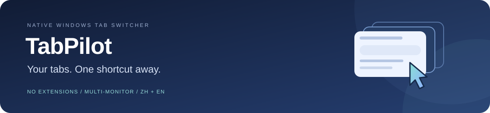
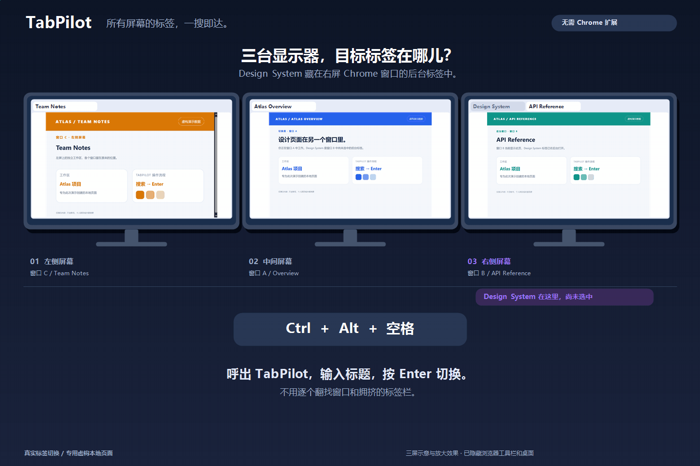
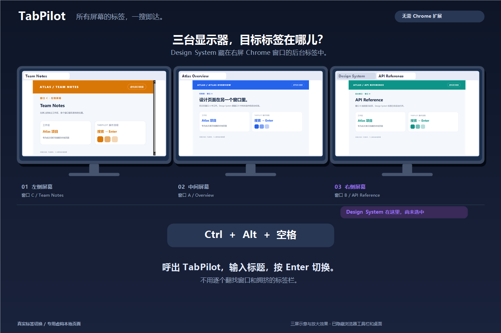
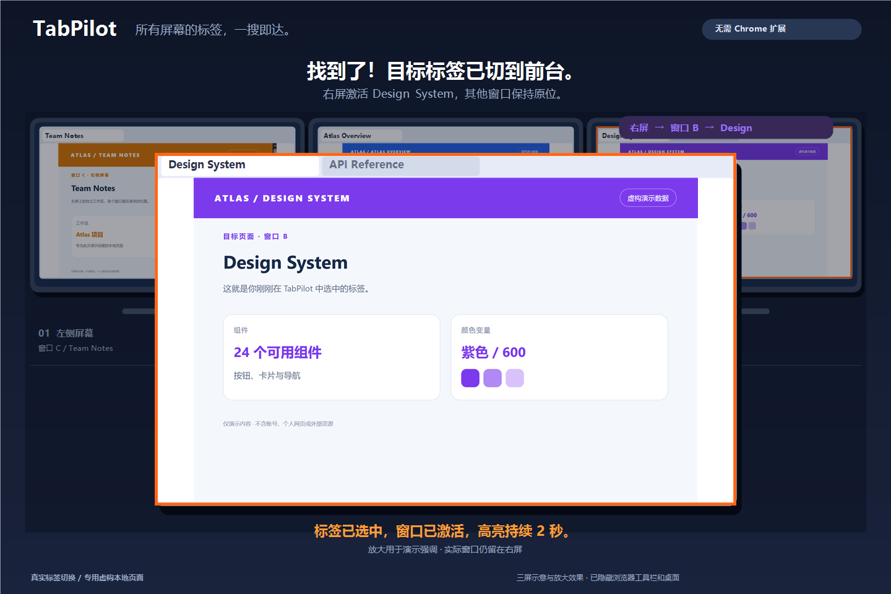
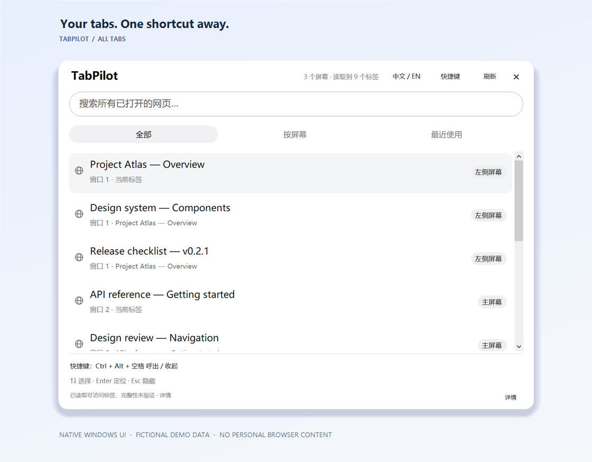
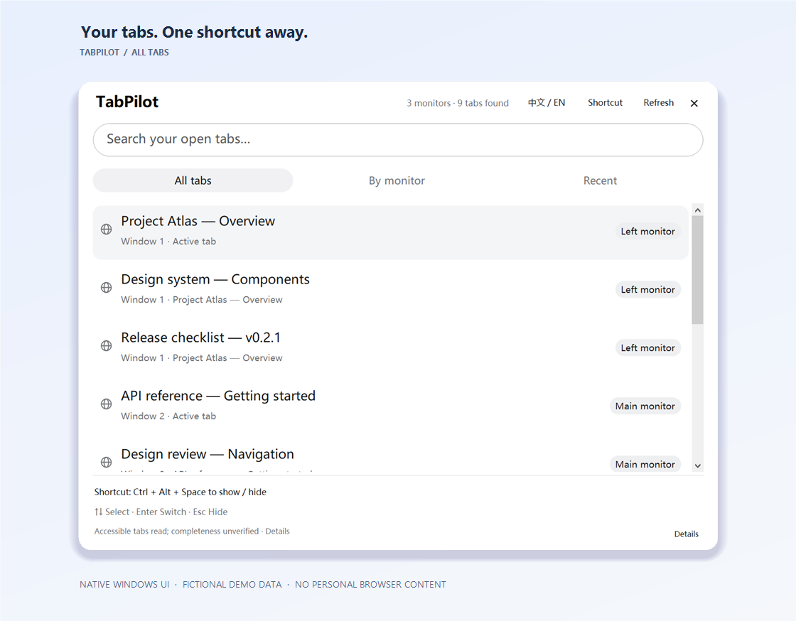
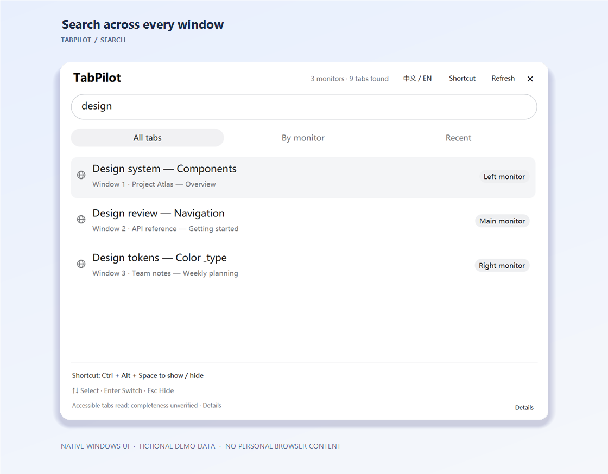
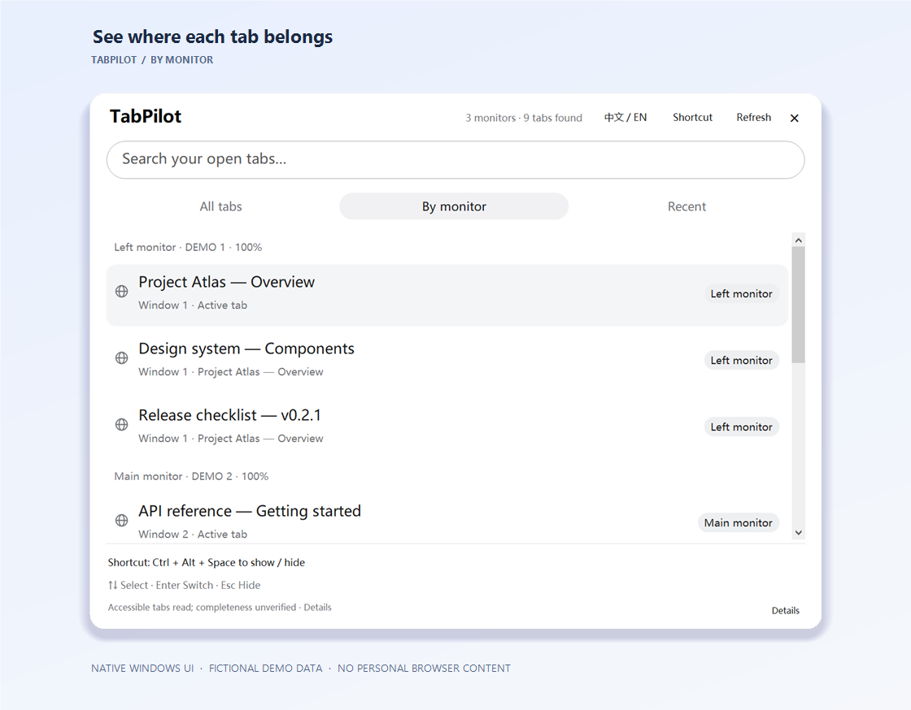

<div align="center">



### 把标签找回来，把注意力留给工作。

[简体中文](README.md) · [English](README.en.md) · [日本語](README.ja.md) · [Español](README.es.md)

**[↓ 下载 Windows 便携版](https://github.com/aqvello/TabPilot/releases/tag/v0.2.1)** · [从源码构建](#build) · [兼容性与限制](#limits)

Windows x64 · .NET Framework 4.8 · UI: 简体中文 / English · v0.2.1 Preview

</div>

无需 Chrome 扩展的 **Windows 多窗口、多屏标签切换器**。按快捷键呼出，搜索标题，回到需要的标签。

| | |
| :--- | :--- |
| **⌨ 快捷呼出** | 标题搜索、↑↓ 选择、Enter 切换。 |
| **▦ 多屏定位** | 按显示器分组，支持混合 DPI，记住浮窗位置。 |
| **◉ 原生与本地** | UI Automation / Win32；无需重启或改动 Chrome。 |

## 看一遍操作流程



不用挨个翻窗口找标签。按快捷键呼出 TabPilot，搜到「Design System」后按 Enter，就能切到右屏的目标标签。橙色边框会标出它所在的窗口。

演示使用示例页面，放大效果仅为方便观看。[素材说明](docs/assets/README.md)

| 切换前：三屏总览，目标标签在右屏后台 | 切换后：右屏目标窗口置前并放大展示 |
| :---: | :---: |
|  |  |

## 中英文界面

| 简体中文 | English |
| :---: | :---: |
|  |  |

<details>
<summary>展开：搜索与按屏幕分组</summary>

| 标题搜索 | 按屏幕分组 |
| :---: | :---: |
|  |  |

</details>

## 一分钟开始使用

1. 从预览版 Release 下载 `TabPilot-Windows-x64.zip` 并解压。
2. 运行 `TabPilot.exe`，保留同目录的 `.config` 文件。
3. 按注册成功的快捷键呼出。默认 **Ctrl + Alt + 空格**；被占用时会尝试替代组合键，实际按键显示在浮窗中。
4. 输入标题搜索，点击结果或按 ↑↓、Enter。目标窗口会激活并显示约两秒高亮。Esc 或点击外部收起，程序保留在托盘。

需要 Windows 10 1703+ x64 与 .NET Framework 4.8。当前为 **v0.2.1 预览版**；实际验证环境为 Windows 10 / Chrome 156，不保证所有版本兼容。

## 选择语言

软件支持 **简体中文 / English**。点击浮窗右上角 **中文 / EN**，或托盘菜单 **Language / 语言**；选择立即生效并会在重启后保留。网页标题始终保留原文，系统和 Chrome 的底层诊断可能保留原始语言。README 另有日文、西班牙文版本，它们不代表软件已支持这两种界面语言。

## 常用操作

| 操作 | 按键 / 入口 |
| :--- | :--- |
| 呼出 / 收起 | 已注册的全局快捷键 |
| 选择并切换 | ↑↓ / Enter |
| 隐藏 / 退出 | Esc / Ctrl + Q |
| 刷新标签 | F5 / Ctrl + R |
| 全部 / 按屏幕 / 最近使用 | Ctrl + 1 / 2 / 3 |
| 记住位置 | 拖动顶部标题 |

<a id="limits"></a>

## 兼容性与限制

- **可访问清单不等于全部标签。** 折叠组、权限或 Provider 行为可能导致遗漏；界面标明“读取到”和完整性未验证。
- **激活受到 Windows 策略限制。** 弹窗、权限差异或焦点竞争可能导致失败。程序会核验结果并报告原因。
- 复杂折叠组、管理员级 Chrome、虚拟桌面等环境未充分验证；不宣称全面支持。
- 后台标签 URL 没有可靠数据源，副标题显示所属窗口；“最近使用”只记录通过 TabPilot 成功切换过的标签。

## 数据与隐私

TabPilot 本身不上传标签数据，不读取 Chrome 配置、历史或会话文件。自己的设置与诊断优先写入便携 `data` 目录，不可写时使用 `%LOCALAPPDATA%\TabPilot`。设置有备份、原子替换和失败重试；诊断可能包含标题，请在分享前检查。文档媒体只展示专用虚构页面与程序控件，生成方式见 [素材说明](docs/assets/README.md)。

<a id="build"></a>

## 从源码构建

使用系统 .NET Framework 编译器，无需 .NET SDK 或 NuGet 下载：

```powershell
git clone https://github.com/aqvello/TabPilot.git
Set-Location TabPilot
powershell -NoProfile -ExecutionPolicy Bypass -File .\build.ps1
.\bin\TabPilot.exe
```

## 测试与实现

```powershell
powershell -NoProfile -ExecutionPolicy Bypass -File .\tests\build-gui-checks.ps1
.\bin\GuiChecks.exe
.\bin\TabPilot.Cli.exe self-test
powershell -NoProfile -ExecutionPolicy Bypass -File .\package.ps1
powershell -NoProfile -ExecutionPolicy Bypass -File .\tests\release-checks.ps1
```

内核自检 8 项、GUI／模型回归 77 项；多语言新增检查覆盖界面、诊断、搜索、标题保持和设置兼容。真实三屏检查与故障记录单独记录，合成演示不作为 Chrome 兼容性证据。

[GUI 验证](docs/GUI_VALIDATION.md) · [内核验证](docs/VALIDATION.md) · [控制台接口](docs/CONSOLE_POC.md) · [更新记录](CHANGELOG.md)

原生 GUI 集成脚本会操作实际窗口，部分依赖本机屏幕坐标和私有测试前状态文件，请按自己的环境准备。原始截图、个人设置、标签清单和日志不会进入仓库或发布包。

[MIT License](LICENSE) · Copyright © 2026 aqvello
